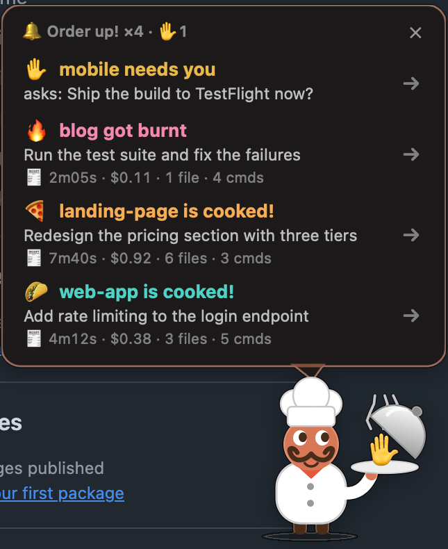
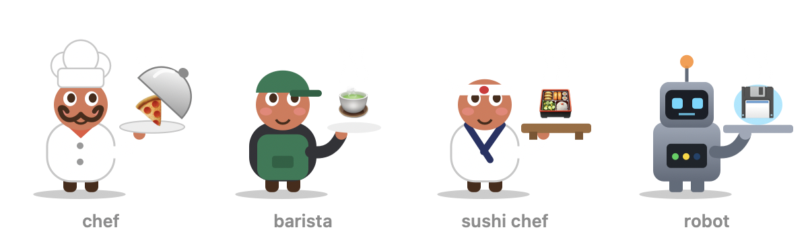
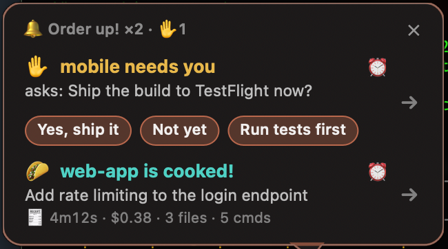
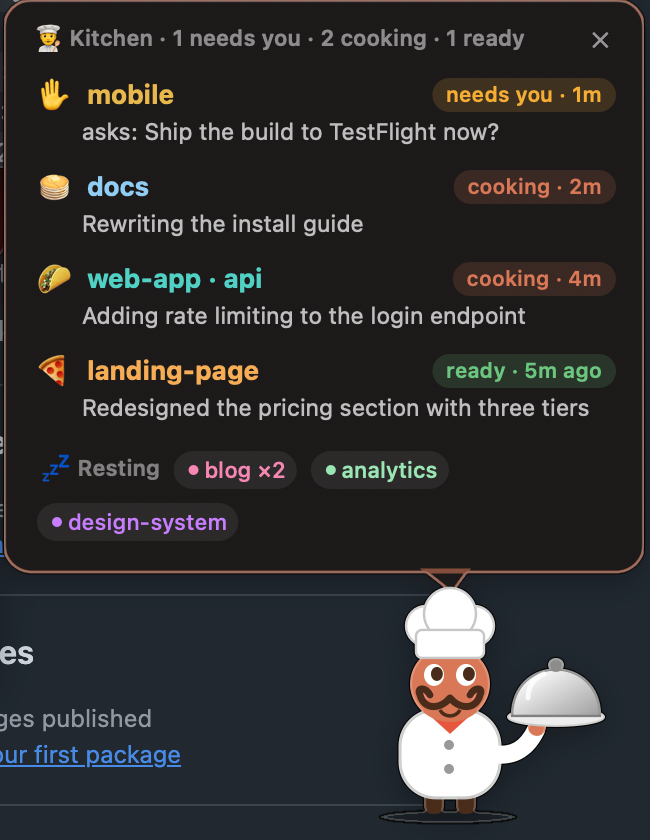

# 🍳 order-up

**A Claude Code mod that tells you when a session is done.** When a Claude Code session finishes, or needs you, in a terminal tab you're not looking at, a tiny chef pops up in the corner of your Mac with the order. Answer it right there, snooze it, or click it and you're back in that exact tab.

🌐 [yugantar7.github.io/order-up](https://yugantar7.github.io/order-up/)

<p align="center"></p>

Built for people who run several Claude Code sessions at once and lose track of which one finished.

## What it does

- **Order up:** a turn that took a while (30s by default) finishes in a session you're not looking at → the chef hops in, rings a bell and lifts the lid on that project's dish. Each project gets its own dish and color.
- **Needs you, and answer from the chef:** a session stops to ask you something or wants a permission → a ✋ order, with the question. When it's a question with choices, the choices are buttons: click one and Claude gets your answer without you switching tabs (permission prompts still need the tab).
- **Burnt dish:** the turn ended in an error, or its last command failed → the dish comes out burnt 🔥 and the chef frowns.
- **The bill:** each order shows how long it took, what it cost, how many files it changed and commands it ran.
- **One chef, one list:** several orders stack in one bubble; past about four orders' height the list scrolls. Click one to jump to its session; it also leaves by itself once you look at that session; ✕ clears them all.
- **Snooze:** the ⏰ on an order puts it away for 10 minutes; it comes back with a hop. Right-click the menu bar chef to snooze them all.
- **Gets impatient:** leave an order waiting and the chef starts rattling the lid, more after five minutes.
- **Menu bar chef:** a tiny chef in your menu bar, with the number of orders waiting (or `✋` when a session needs you, `2🍳` while sessions cook). Click it to call the chef out any time: it shows the orders, or, with none waiting, the **kitchen**: every Claude session, what it's doing and for how long; click one to jump there. Click the icon again (or ✕) to send the chef back; right-click for the menu.
- **With no Claude running:** by default the menu bar chef leaves when your last session ends and comes back with the next one. Answer "Always" in setup and it stays in the menu bar and starts at login ("Nothing cooking" until a session starts).

## Pick your character

<p align="center"></p>

Four skins, each with its own words and dishes: the **chef** ("Order up!", "is cooked!"), a **barista** ("Coffee's up!", "is brewed!"), a **sushi chef** ("Irasshaimase!", "is plated!") and a **robot** ("Task complete", "hit an error"). Pick one in setup, or any time with `/order-up set skin barista`.

## A closer look

<table>
<tr>
<td align="center" valign="top"><br><sub><b>Answer from the chef</b>: short answers are pills, long ones get full-width buttons; ⏰ snoozes; past four orders the list scrolls</sub></td>
<td align="center" valign="top"><br><sub><b>The kitchen</b>: click the menu bar chef to see every session</sub></td>
</tr>
</table>

## FAQ

**How do I get notified when Claude Code finishes?** Install order-up: when a Claude Code turn that ran for a while finishes in a tab you're not looking at, the chef pops up with the result. Click it to jump back.

**What is a Claude Code mod?** A mod changes Claude Code itself (how it looks, behaves, or what it can do). Mods are plugins with hooks; order-up is one.

**Can I answer Claude Code's questions without switching tabs?** Yes, for questions with choices: they show as buttons on the chef. Permission prompts still need the tab.

**How do I keep track of many Claude Code sessions?** Click the menu bar chef to see the kitchen: every session, its state and what it's doing.

## Install

Needs macOS and Apple's Command Line Tools (for Swift; `xcode-select --install` if you don't have them).

```sh
claude plugin marketplace add yugantar7/order-up
claude plugin install order-up@order-up
```

Or inside Claude Code: `/plugin install order-up --marketplace yugantar7/order-up`. Then start a new session and run:

```
/order-up setup
```

Setup checks your Mac, asks a few quick questions (your character, when to pop up, what each order says, needs-you on/off, corner, sound, menu bar, and whether the menu bar chef stays when no Claude session runs), builds the chef app and serves a test order. Run it again any time to change your answers.

## Updating

Claude Code doesn't update plugins from other people's marketplaces on its own until you say so. Turn it on once: run `/plugin`, open **Marketplaces**, pick **order-up**, choose **Enable auto-update**. New versions then arrive by themselves, and Claude Code tells you "Plugin updated: order-up · Run /reload-plugins to apply" (a new session picks it up too).

Or update by hand:

```sh
claude plugin marketplace update order-up
claude plugin update order-up@order-up
```

The chef app catches up by itself: the first session after an update rebuilds it in the background and shows "🍳 order-up updated to …". What changed is in the [releases](https://github.com/yugantar7/order-up/releases).

## Terminals

| Where Claude Code runs | Click an order → |
|---|---|
| Terminal.app, iTerm2 | that exact tab |
| Ghostty, Warp, VS Code, Cursor, the Claude desktop app | that app's window |

The first click in Terminal.app or iTerm2 makes macOS ask whether OrderUp may control it: allow it, or clicks can't switch tabs.

## Commands

- `/order-up setup` — the setup questions; (re)builds the chef app
- `/order-up config` — every setting and its current value
- `/order-up set <name> <value>` — change one, in plain words: `/order-up set corner top right`, `/order-up set sound off`, `/order-up set after 2 min`
- `/order-up test` — serves a test order
- `/order-up status` — what it knows about this session
- `/order-up off` / `on`

## Settings

Set them on the install screen, with `/order-up setup` or `/order-up set`, or in Claude Code's own `/config` menu under order-up. They are the same settings wherever you change them.

| Name | Values | What it does |
|---|---|---|
| `skin` | **chef** · barista · sushi · robot | who serves your orders |
| `after` | every turn · **30s** · 1 min · 2 min · 5 min | how long a turn must run before it becomes an order |
| `summary` | **your prompt** · haiku summary · nothing | what each order says (a Haiku summary costs about $0.001 a turn, billed to your Claude account) |
| `needsYou` | **on** · off | also pop up when a session asks you something or wants a permission |
| `corner` | **bottom right** · bottom left · top right | where the chef stands |
| `sound` | **on** · off | ring a bell when an order is up |
| `menubar` | **on** · off | the tiny chef in the menu bar |
| `alwaysOn` | on · **off** | keep the menu bar chef even with no Claude session running, and start it at login |

A project's own color and dish go in `~/.claude/order-up/settings.json` (the project is the git repository's name, else the folder's):

```json
{ "projects": { "web-app": { "color": "#4FD1C5", "dish": "🌮" } } }
```

## Privacy

order-up makes no network calls of its own. It reads and writes only `~/.claude/order-up/` (plus, if you choose "Always", one login item at `~/Library/LaunchAgents/dev.order-up.chef.plist`) (orders, a heartbeat per session, settings and a log of why orders came and went). With `summary: "haiku"` it asks Claude Haiku for the summary through Claude Code itself. The chef app is built on your Mac from `helper/OrderUp.swift`; read it before you build it.

## Uninstall

```sh
claude plugin uninstall order-up@order-up
rm -f ~/Library/LaunchAgents/dev.order-up.chef.plist
rm -rf ~/.claude/order-up
```

## How it works

The mod (`hooks/register.ts`) watches your session: when a turn ends, a question waits, or a permission prompt shows, it writes an order to `~/.claude/order-up/queue/<session>.json` and opens the app. The app (`helper/OrderUp.swift`, one Swift file) draws the chef, checks which app and tab is in front, and jumps there with AppleScript (Terminal.app, iTerm2) or by bringing the app forward. Tests: `claude plugin test .`

MIT licensed.
